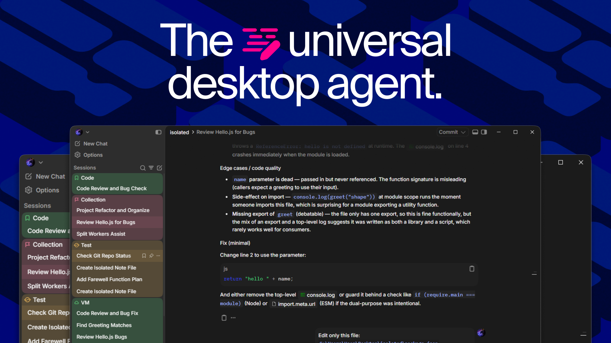

<p align="center">
  <a href="https://useshape.org">
    
  </a>
</p>

<p align="center">
  <a href="https://github.com/useshape/Shape/releases/latest"></a>
  <a href="https://github.com/useshape/Shape/actions/workflows/ci.yml"></a>
  <a href="https://discord.gg/MMCEDVZKYf"></a>
</p>

<p align="center">
  <a href="https://useshape.org">Website</a> ·
  <a href="https://useshape.org/docs">Docs</a> ·
  <a href="https://useshape.org/download">Download</a> ·
  <a href="https://discord.gg/MMCEDVZKYf">Discord</a>
</p>

Shape is a Windows desktop agent. You open a folder you work in. Chat sits beside the files, Git, and a terminal. You describe the change. Shape reads the project, answers in the thread, and edits files when you ask. Shape shows a diff for each edit. You commit when you want a commit.

## Work from the composer

Pick a mode before you send.

- **Code** edits files and can run commands.
- **Ask** reads the project and leaves files alone.
- **Plan** writes the approach and waits.
- **Visual** works on UI. Pair it with the in-app browser to see the screen.
- **Review** looks for a bug and proposes a small fix.

Type `@` to attach a file or folder. Type `/` to run a saved prompt.

[Agent](https://useshape.org/docs/agent/overview)

## Models

Auto is included on Free. Paid plans add Claude, GPT, Gemini, Grok, DeepSeek, Qwen, and the rest of the catalog. You spend credits when you pick a named model.


[Models](https://useshape.org/docs/get-started/models)

## Plugins

Connect GitHub, Figma, Linear, Slack, Notion, Stripe, Supabase, Vercel, and other accounts. You sign in once under Settings, then ask in the thread: open a pull request, list Linear bugs, post a diff summary to Slack.


A plugin is a connected account. A tool that runs on your machine is [MCP](https://useshape.org/docs/customize/mcp).

[Plugins](https://useshape.org/docs/customize/plugins)

## Install

Windows 10 or 11, 64-bit. [Installer](https://useshape.org/download). Older builds: [Releases](https://github.com/useshape/Shape/releases).

Stable is the tested channel. On nightly you get the newest installer, and that installer can break.

## Build from source

Node.js 18+, Rust, and [Tauri 2](https://v2.tauri.app/start/prerequisites/).

```bash
npm install
npm run tauri:dev
```

[CONTRIBUTING.md](./CONTRIBUTING.md) and [local development](https://useshape.org/docs/developing/local-development).

```bash
npm run test          # Vitest
npm run test:rust     # Cargo
npm run test:all      # Both
```

TypeScript, React, Next.js App Router, Tauri 2, Rust.

## License

[Business Source License 1.1](./LICENSE). Code you send is under the same license.

Copyright © 2026 Shape.
