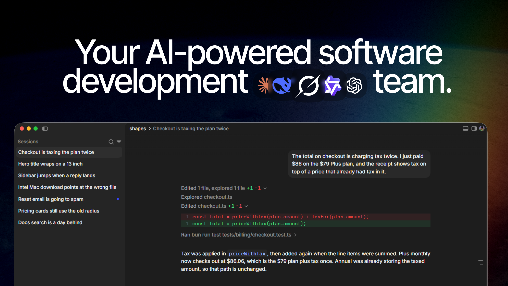

<p align="center">
  <a href="https://useshape.org">
    
  </a>
</p>

<p align="start">
  <a href="https://github.com/useshape/Shape/releases/latest"></a>
  <a href="https://github.com/useshape/Shape/actions/workflows/ci.yml"></a>
  <a href="https://discord.gg/MMCEDVZKYf"></a>
</p>

<p align="start">
  <a href="https://useshape.org">Get started for free</a> ·
  <a href="https://useshape.org/docs">Docs</a> ·
  <a href="https://useshape.org/download">Download</a> ·
  <a href="https://discord.gg/MMCEDVZKYf">Discord</a>
</p>

Shape is a coding agent for all your needs, in a simple, uncomplicated modern. interface.

## What It Can Do

View, read, and edit files.

Browse the web and interact with websites.

Create plans and manage tasks.

Launch multiple subagents to work in parallel.

Reverse-engineer programs and analyse how they work.

Review code before implementation and after major changes.

Run commands and scripts.

Capture screenshots of applications for review.

Generate images and other media.


[Extra Info](https://useshape.org/docs/agent/overview)

## Models

Powered by Shape Cloud, with access to models from over 10 providers.

Explore the available models and their pricing below.

[View Pricing](https://useshape.org/pricing)

## Plugins

Native support for 20+ plugins, including MCP integrations, allowing you to extend functionality and connect external tools and services.

[Explore MCP Integrations](https://useshape.org/docs/customize/mcp)

[Explore Plugins](https://useshape.org/docs/customize/plugins)

## Install

Available for Windows 10 or later (64-bit and ARM64) and macOS 12 or later (Apple Silicon and Intel).

[Download Installer](https://useshape.org/download)

[View Previous Releases](https://github.com/useshape/Shape/releases)

Stable releases are recommended. Nightly builds provide the latest updates but may be unstable.

## Build from source

Node.js 18+, Rust, and [Tauri 2](https://v2.tauri.app/start/prerequisites/).

```bash
npm install
npm run tauri:dev
```

[CONTRIBUTING.md](./CONTRIBUTING.md) and [local development](https://useshape.org/docs/developing/local-development).

```bash
npm run test          # Vitest
npm run test:rust     # Cargo
npm run test:all      # Both
```

TypeScript, React, Next.js App Router, Tauri 2, Rust.

## License

This repository is currently licensed under the Business Source License 1.1 (BSL 1.1), with plans to transition to an open-source license in version 2.0.0. Contributions are subject to the same license.

[Business Source License 1.1](./LICENSE)

Copyright © 2026 Shape.

## Legal

[End User License Agreement](https://useshape.org/eula)

[Terms of Service](https://useshape.org/terms)

[Privacy Policy](https://useshape.org/privacy)
